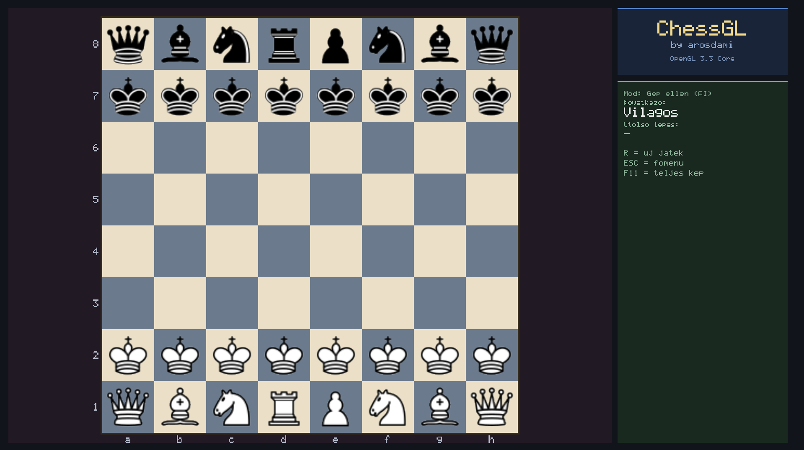



Egy modern, C nyelven íródott sakkjáték OpenGL 3.3 Core Profile grafikával.
A projekt egy egyetemi bemutató keretein belül készült, saját shaderekkel,
saját sakk-logikával és gép elleni móddal.

## Képernyőkép

## Készítette

- **Név:** Aros Damján
- **Tantárgy:** 3D modellezés és játékfejlesztés
- **Oktató:** Dr. Mileff Péter

## Technológiák

- **Nyelv:** C (C11)
- **Grafika:** OpenGL 3.3 Core Profile – saját vertex- és fragment shader
- **Ablakkezelés:** GLFW 3.5
- **OpenGL függvénybetöltő:** GLAD
- **Képbetöltés:** stb_image (single-header library)
- **Fordító:** GCC (MinGW-w64 UCRT)

## Funkciók

- Modern, sötét színvilágú főmenü
- Kétjátékos mód (ugyanazon a gépen, felváltva lépve)
- Gép elleni mód (minimax algoritmus alpha-béta vágással)
- Teljes sakk-szabályrendszer:
  - Minden bábu szabályos lépése (gyalog, bástya, huszár, futó, királynő, király)
  - Ütésvizsgálat
  - Gyalogátváltozás (királynővé)
  - Sakk-matt és patt felismerése
- Textúrázott sakkfigurák – minden bábu egyedi képpel
- Saját arckép a névjegyben – kör alakban megjelenítve
- Kijelölt bábu és a lehetséges lépések vizuális jelölése
- Egérkezelés
- Teljes képernyős mód (F11)
- Saját sakkfigura-ikon az EXE fájlon és az ablakon

## Fordítás és futtatás

A projekt Windows alatt, MinGW-w64 GCC-vel és GLFW-vel fordítható.

### Szükséges könyvtárak

- **GLFW 3.5** – ablakkezelés és bemenet (a repóban megtalálható a **lib/** mappában)
- **GLAD** – OpenGL függvénybetöltő (a **src/glad.c** és az **include/glad/** mappában)
- **stb_image.h** – PNG-kép betöltő könyvtár (az **include/** mappában)
- **OpenGL** – a rendszer része

### Fordítási folyamat

A program három lépésben épül fel:

1. **Ikon erőforrás fordítása** – a **resources/sakk.ico** ikonból **windres**
   segítségével **ikon.o** objektumfájl készül.
2. **Forrásfájlok fordítása** – a **src/** mappában található összes **.c** fájlt
   a **gcc** lefordítja **.o** objektumfájlokká.
3. **Linkelés** – az objektumfájlokat és a GLFW könyvtárat összefűzi a linker,
   és elkészül a **ChessGL.exe** futtatható állomány.

### Manuális fordítás

Nyiss egy PowerShell ablakot a projekt mappájában, és add ki a következő parancsot:

    gcc -Wall -Wextra -std=c11 -Iinclude -Isrc ^
        src/main.c src/tabla.c src/rajz.c src/menu.c src/ai.c src/babu.c src/glad.c src/stb_impl.c ^
        resources/ikon.o ^
        -o ChessGL.exe ^
        -Llib -lglfw3 -lopengl32 -lgdi32 -lm

Ez lefordítja a projektet, és létrehozza a **ChessGL.exe** futtatható állományt.

### Futtatás

    .\ChessGL.exe

## Irányítás

| Gomb | Funkció |
|------|---------|
| **Bal egér gomb** | Bábu kiválasztása, majd célmező kattintása |
| **ESC** | Vissza a főmenübe / Kilépés |
| **F11** | Teljes képernyő ki/be |

## Játékmenet

1. Indítás után a **főmenüben** vagy.
2. Válaszd a **„Duel"** (2 játékos) vagy az **„AiChess"** (gép ellen) opciót.
3. A sakktáblán kattints a saját bábúdra – a lehetséges lépések zölddel kiemelődnek.
4. Kattints a célmezőre a lépés végrehajtásához.
5. A játék addig tart, amíg valamelyik fél mattot nem kap, vagy patt nem lesz.

## Projekt struktúra

    ChessGL/
    |-- ChessGL.exe            (a lefordított program)
    |-- glfw3.dll              (GLFW dinamikus könyvtár)
    |-- README.md
    |
    |-- include/               (fejléc fájlok)
    |   |-- GLFW/
    |   |-- glad/
    |   |-- KHR/
    |   +-- stb_image.h
    |
    |-- lib/                   (GLFW statikus könyvtárak)
    |-- shaders/               (OpenGL shaderek)
    |   |-- vertex.glsl
    |   +-- fragment.glsl
    |
    |-- resources/             (erőforrások)
    |   |-- sakk.ico           (EXE ikon)
    |   |-- icon.png           (ablak ikon)
    |   |-- babuk.png          (sakkfigurák sprite sheet)
    |   |-- creator.png        (szerzői arckép)
    |   +-- ikon.rc            (ikon erőforrás fájl)
    |
    |-- screenshots/           (képernyőképek)
    +-- src/                   (forrásfájlok)
        |-- main.c             (fő program, menük, képernyőkezelés)
        |-- tabla.c / tabla.h  (sakk logika, bábuk lépései)
        |-- rajz.c / rajz.h    (OpenGL primitívek, szöveg- és textúra-kezelés)
        |-- babu.c / babu.h    (sakkfigurák rajzolása)
        |-- menu.c / menu.h    (képernyő-váltás kezelése)
        |-- ai.c / ai.h        (minimax AI alpha-béta vágással)
        |-- stb_impl.c         (stb_image implementáció)
        +-- glad.c             (GLAD betöltő)

## Fejlesztési megjegyzések

- A program **NEM** használ külső 3D modell fájlokat – a sakkfigurák egyetlen
  **sprite sheet** textúráról (babuk.png) töltődnek be.
- A **szövegrenderelés** egy saját 5×7-es bitmap fonttal történik.
- A **shaderek** külön fájlban vannak (shaders/ mappa).
- Az **AI** a minimax algoritmust használja alpha-béta vágással.
- A **textúrák** stb_image.h-val töltődnek be, ami egy header-only könyvtár.

## Ismert korlátozások

- Nincs sáncolás (castling) és en passant támogatás
- Az AI nem veszi észre a közvetlen matt-veszélyt, csak az anyagi előnyt

## GitHub

https://github.com/arosdami/ChessGL

## Licenc

Ez a projekt egyetemi bemutató céljából készült. Szabadon felhasználható
tanulási célokra.