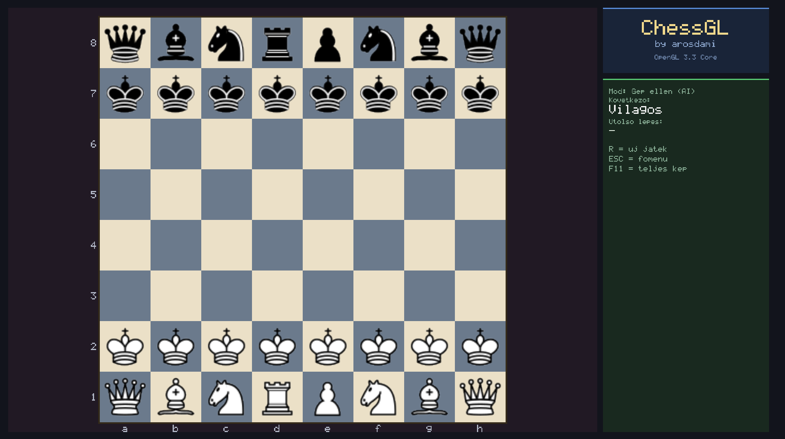

 <div align="center">
  
</div>

<div align="center">
  <a href="https://github.com/arosdami/ChessGL"></a>
  <a href="https://github.com/arosdami/ChessGL/releases"></a>
  <a href="#build-and-run"></a>
  <a href="#gameplay"></a>
</div>

<p align="center">
  A chess program written in C, featuring OpenGL 3.3 Core Profile rendering,
  local two-player gameplay, and a Minimax-based AI opponent.
</p>

## Features

- Local two-player mode with alternating turns
- Single-player mode with three difficulty levels
- Piece movement, captures, pawn promotion, check, checkmate, and stalemate handling
- Visual highlighting of selected pieces and valid destination squares
- Dark-themed main menu and in-game menu
- 2D chess pieces loaded from a sprite sheet
- Fullscreen mode toggled with the `F11` key
- Embedded Windows application icon



## Technologies

- **Language:** C11
- **Graphics:** OpenGL 3.3 Core Profile
- **Window management and input:** GLFW 3.x
- **OpenGL function loading:** GLAD
- **Image loading:** `stb_image.h`
- **Compiler:** GCC / MinGW-w64

## Prerequisites

The project is designed for Windows and the MSYS2 UCRT64 environment. The `gcc` and `windres` commands required for compilation must be available in the system PATH.

By default, `build_and_run.bat` also adds the `C:\msys64\ucrt64\bin` directory to the PATH.

The GLFW static libraries, GLAD, and `stb_image.h` are already included in the repository, so no separate package manager or external dependencies are required.

## Build and Run

### Manual compilation

From the project root directory in the MSYS2 UCRT64 environment:

```bat
windres resources\ikon.rc -O coff -o resources\ikon.o

gcc -mwindows -Wall -Wextra -std=c11 -Iinclude -Isrc ^
    src\main.c src\jatek_rajz.c src\tabla.c src\rajz.c src\menu.c src\ai.c src\babu.c src\glad.c src\stb_impl.c ^
    resources\ikon.o ^
    -o ChessGL.exe ^
    -Llib -lglfw3 -lopengl32 -lgdi32 -lm
```

To launch the application:

```bat
ChessGL.exe
```

The `resources\ikon.o` file is a precompiled resource object. If you need to regenerate it, the icon resource is compiled from `resources\ikon.rc` and `resources\sakk.ico` using the `windres` command.

## Controls

| Key / Input | Action |
|---|---|
| Left mouse button | Select a piece, then select its destination square |
| `ESC` | Return to the main menu or pause the game |
| `R` | Restart the current game mode |
| `F11` | Toggle fullscreen mode |

## Gameplay

1. Launch the application and select **New Game** (local two-player mode) or **AiChess** (play against the computer).
2. In AI mode, select a difficulty level: **Easy**, **Normal**, or **Hard**.
3. Click the piece you want to move.
4. The program highlights valid destination squares in green.
5. Click the desired square to complete the move.
6. Press `ESC` to return to the menu. Select **Continue** to resume the game.
7. The game ends when checkmate or stalemate occurs.

## Project Structure

The following directory tree represents the current project working directory. It does not include the `.git` directory.

The `ChessGL.exe`, `resources\ikon.o`, and batch files are generated or local build files and are therefore excluded from version control through `.gitignore`.

```text
ChessGL/
├── .gitignore
├── LICENSE
├── README.md
├── ChessGL.exe
├── glfw3.dll
├── include/
│   ├── glad/
│   │   └── glad.h
│   ├── GLFW/
│   │   ├── glfw3.h
│   │   └── glfw3native.h
│   ├── include/
│   │   └── GLFW/
│   │       ├── glfw3.h
│   │       └── glfw3native.h
│   ├── KHR/
│   │   └── khrplatform.h
│   └── stb_image.h
├── lib/
│   ├── libglfw3.a
│   └── libglfw3dll.a
├── resources/
│   ├── babuk.png
│   ├── babuk.svg
│   ├── creator.png
│   ├── icon.png
│   ├── ikon.o
│   ├── ikon.rc
│   └── sakk.ico
├── screenshots/
│   ├── logo-removebg-preview.png
│   ├── logo.png
│   ├── mainmenu.png
│   └── sakk.png
├── shaders/
│   ├── fragment.glsl
│   └── vertex.glsl
└── src/
    ├── ai.c
    ├── ai.h
    ├── babu.c
    ├── babu.h
    ├── glad.c
    ├── jatek_rajz.c
    ├── jatek_rajz.h
    ├── main.c
    ├── menu.c
    ├── menu.h
    ├── rajz.c
    ├── rajz.h
    ├── stb_impl.c
    ├── tabla.c
    ├── tabla.h
    └── ui_konstansok.h
```

## Implementation Details

- Rendering uses a sprite sheet instead of an external 3D model loader.
- GLSL vertex and fragment shaders are stored in separate files.
- The computer opponent uses the Minimax algorithm with alpha-beta pruning.
- Image loading is handled by the single-header `stb_image.h` library.

## Known Limitations

- Castling and en passant are not currently implemented.
- The AI evaluation primarily relies on material advantage, so it does not always recognize deeper strategic plans and combinations.

## Author and Course

- **Author:** Aros Damján
- **Course:** 3D Modeling and Game Development
- **Instructor:** Dr. Péter Mileff

## Repository

- GitHub: [arosdami/ChessGL](https://github.com/arosdami/ChessGL)
- XERJ Reference Corpus: [arosdami](https://hub.xerj.org/contributors/arosdami)

## License

This project is distributed under the terms of the [MIT License](LICENSE).
