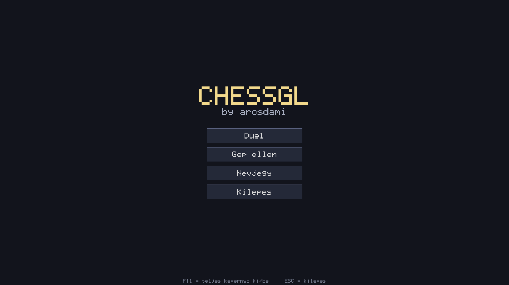

# ChessGL - OpenGL Sakkjatek

Egy modern, C nyelven irodott sakkjatek OpenGL 3.3 Core Profile grafikaval.
A projekt egy egyetemi bemutato keretein belul keszult, sajat shaderekkel,
sajat sakk-logikaval es gep elleni moddal.

## Kepernyokepek

### Fomenu

### Jatekter

## Keszitette

- **Nev:** Aros Damjan
- **Tantargy:** 3D modellezes es jatekfejlesztes
- **Oktato:** Dr. Mileff Peter

## Technologiak

- **Nyelv:** C (C11)
- **Grafika:** OpenGL 3.3 Core Profile - sajat vertex- es fragment shader
- **Ablakkezeles:** GLFW 3.5
- **OpenGL fuggvenybetolto:** GLAD
- **Fordito:** GCC (MinGW-w64 UCRT)

## Funkciok

- Modern, sotet szinvilagu fomenu
- Ket jatekos mod (ugyanazon a gepen, felvaltva lepve)
- Gep elleni mod (minimax algoritmus alpha-beta vagassal)
- Teljes sakk-szabalyrendszer
- Kivalasztott babu es a lehetseges lepesek vizualis jelolese
- Egeres interakcio
- Teljes kepernyos mod (F11)
- Sajat sakkfigura-ikon az EXE fajlon
- Easter egg

## Forditas es futtatas

### Elokeszuletek

- **MinGW-w64 GCC** (javasolt: MSYS2 UCRT64 verzio)
- **GLFW 3.5** fejlec- es konyvtarfajlok (a repoban megtalalhatok)
- **GLAD** (a repoban megtalalhato)

### Forditas

Dupla kattints a **build_and_run.bat** fajlra, vagy PowerShell-bol:

    .\build_and_run.bat

Ez leforditja a projektet, majd elinditja a **ChessGL.exe**-t.

### Csak forditas (futtatas nelkul)

    .\build.bat

### Futtatas

    .\run.bat

## Iranyitas

| Gomb | Funkcio |
|------|---------|
| **Bal eger gomb** | Babu kivalasztasa, majd celmezo kattintasa |
| **ESC** | Vissza a fomenube / Kilepes |
| **F11** | Teljes kepernyo ki/be |
| **E** | Easter egg be/ki |

## Jatekmenet

1. Inditas utan a **fomenuben** vagy.
2. Valaszd az **"Uj jatek (2 jatekos)"** vagy a **"Gep ellen"** opciot.
3. A sakktablan kattints a sajat babudra - a lehetseges lepesek zolddel kiemelodnek.
4. Kattints a celmezore a lepes vegrehajtasahoz.
5. A jatek addig tart, amig valamelyik fel mattot nem kap, vagy patt nem lesz.

## Projekt struktura

    ChessGL/
    |-- ChessGL.exe            (a leforditott program)
    |-- glfw3.dll              (GLFW dinamikus konyvtar)
    |-- build.bat              (fordito script)
    |-- build_and_run.bat      (forditas + futtatas)
    |-- run.bat                (csak futtatas)
    |-- README.md
    |
    |-- include/               (fejlec fajlok)
    |-- lib/                   (GLFW statikus konyvtarak)
    |-- shaders/               (OpenGL shaderek)
    |-- resources/             (ikon es egyeb eroforrasok)
    |-- screenshots/           (kepernyokepek)
    +-- src/                   (forrasfajlok)
        |-- main.c             (fo program, fo ciklus, kepernyokezeles)
        |-- tabla.c / tabla.h  (sakk logika, babuk lepesei)
        |-- rajz.c / rajz.h    (OpenGL primitívek, szovegrendering)
        |-- menu.c / menu.h    (kepernyo-valtas kezelese)
        |-- ai.c / ai.h        (minimax AI alpha-beta vagassal)
        +-- glad.c             (GLAD betolto)

## Fejlesztesi megjegyzesek

- A program **NEM** hasznal kulso 3D modell fajlokat - minden babu egyszeru
  geometriai primitivumokbol (kor, negyzet, haromszog) epul fel.
- A **szovegrendering** egy sajat 5x7-es bitmap fonttal tortenik.
- A **shaderek** kulon fajlban vannak (shaders/ mappa).
- Az **AI** a minimax algoritmust hasznalja alpha-beta vagassal.

## Ismert korlataitasok

- Nincs sanconas (castling) es en passant tamogatas
- Az AI nem veszi eszre a kozvetlen matt-veszelyt, csak az anyagi elonyt

## GitHub

https://github.com/arosdami/ChessGL

## Licenc

Ez a projekt egyetemi bemutato celjabol keszult. Szabadon felhasznalhato
tanulasi celokra.
