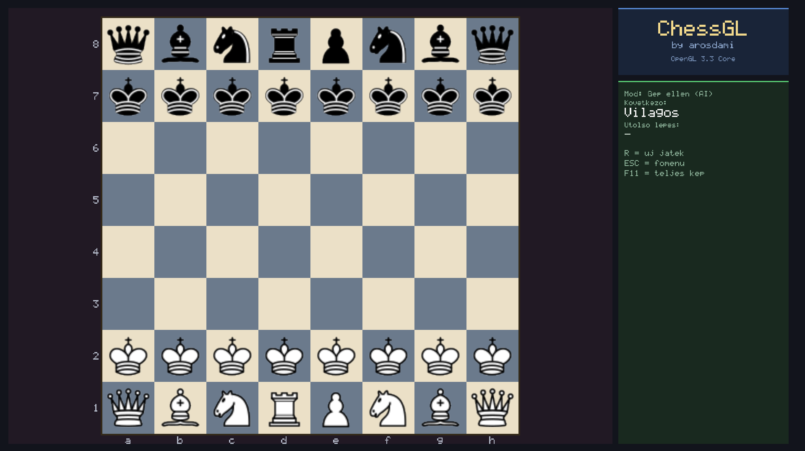

<div align="center">
  
</div>

<div align="center">
  <a href="https://github.com/arosdami/ChessGL"></a>
  <a href="https://github.com/arosdami/ChessGL/releases"></a>
  <a href="#build--run"></a>
  <a href="#gameplay"></a>
</div>

<div align="center" style="margin-top: 10px;">
  <a href="https://hub.xerj.org/contributors/arosdami"></a>
</div>

<p align="center">
A modern chess game written in C that renders the chessboard, UI menus, and pieces using an OpenGL 3.3 Core Profile graphics pipeline. Developed as a university coursework project in 3D modeling and game development, featuring custom GLSL shaders, proprietary chess rule evaluation logic, and single-player gameplay against an AI engine.
</p>

## Features

- Local two-player mode on the same machine with alternating turns
- Single-player AI mode (powered by Minimax with alpha-beta pruning)
- Complete chess rules engine:
  - Standard movement validation for all piece types
  - Capture detection
  - Pawn promotion
  - Check, checkmate, and stalemate detection
- Modern dark-themed user interface and interactive main menu
- Textured 2D chess pieces mapped from a sprite sheet
- Visual highlights for selected pieces and valid target squares
- Fullscreen toggle support (`F11`)
- Custom application icon and executable resource integration



## Technologies

- **Language:** C (C11 standard)
- **Graphics API:** OpenGL 3.3 Core Profile
- **Window Management & Input:** GLFW 3.x
- **OpenGL Function Loader:** GLAD
- **Image Decoding:** `stb_image.h`
- **Compiler Suite:** GCC / MinGW-w64

## Environment & Prerequisites

This project is built and optimized for Windows using MinGW-w64 GCC. The repository includes pre-packaged GLFW static libraries and GLAD header/source dependencies.

### Directories and Assets

- `lib/` – GLFW static library binaries
- `include/` – GLAD and `stb_image` header files
- `src/` – Game engine and logic source code
- `shaders/` – GLSL vertex and fragment shader files
- `resources/` – Windows icons, sprites, textures, and asset files
- `screenshots/` – Documentation images

---

## Manual Compilation

Open PowerShell or Command Prompt in the root directory of the project, then run:

```bat
windres resources\ikon.rc -O coff -o resources\ikon.o

gcc -Wall -Wextra -std=c11 -Iinclude -Isrc ^
    src\main.c src\tabla.c src\rajz.c src\menu.c src\ai.c src\babu.c src\glad.c src\stb_impl.c ^
    resources\ikon.o ^
    -o ChessGL.exe ^
    -Llib -lglfw3 -lopengl32 -lgdi32 -lm
```

Execute the compiled binary:

```bat
.\ChessGL.exe
```

*Note: If you wish to build without embedding the Windows executable icon, simply omit `resources\ikon.o` from the build command.*

---

## Controls

| Key / Input | Action |
|-------------|--------|
| **Left Mouse Button** | Select a piece, then select target square to execute move |
| **ESC** | Return to main menu or pause/resume |
| **R** | Restart game in current mode |
| **F11** | Toggle Fullscreen |

---

## Gameplay

1. Launch the executable and select either **New Game** (PvP) or **AiChess** (PvE) from the main menu.
2. When playing against AI, select the desired difficulty: Easy, Normal, or Hard.
3. Click on your piece on the board to select it.
4. Valid destination squares are highlighted in green.
5. Click on an authorized target square to complete the turn.
6. Press `ESC` at any time to return to the main menu, and select **Continue** to resume play.
7. The match concludes when checkmate or stalemate is reached.

---

## Project Structure

```text
ChessGL/
├── ChessGL.exe             # Compiled executable
├── glfw3.dll               # GLFW dynamic link library
├── README.md               # Project documentation
├── LICENSE                 # License file
├── lib/                    # GLFW static libraries
├── include/                # GLAD and stb_image header files
├── shaders/                # OpenGL shader files
│   ├── vertex.glsl
│   └── fragment.glsl
├── resources/              # Icons, textures, and assets
│   ├── sakk.ico
│   ├── icon.png
│   ├── babuk.png
│   ├── creator.png
│   ├── ikon.rc
│   └── ikon.o              # Compiled resource object
├── screenshots/            # Visual documentation
│   ├── logo.png
│   ├── mainmenu.png
│   └── sakk.png
├── src/                    # Source files
│   ├── main.c
│   ├── tabla.c / tabla.h
│   ├── rajz.c / rajz.h
│   ├── babu.c / babu.h
│   ├── menu.c / menu.h
│   ├── ai.c / ai.h
│   ├── glad.c
│   ├── stb_impl.c
│   └── ...
└── .gitignore
```

---

## Implementation Details

- The rendering pipeline avoids heavy 3D mesh loaders by utilizing a single optimized 2D sprite sheet for all piece variations.
- Custom bitmap font system for in-engine UI rendering without external FreeType bloat.
- Isolated GLSL shaders stored externally under `shaders/`.
- Lightweight Minimax implementation with alpha-beta pruning for deterministic game-tree traversal.
- Single-header `stb_image.h` integration for zero-dependency image loading.

## Known Limitations

- Castling and *en passant* are currently unsupported.
- The AI prioritizes strict material advantage and piece valuation over deep combinatorial checkmate traps.

---

## Author & Academic Information

- **Author:** Aros Damján [](https://hub.xerj.org/contributors/arosdami)
- **Course:** 3D Modeling and Game Development
- **Instructor:** Dr. Péter Mileff

## Repository

- GitHub: [https://github.com/arosdami/ChessGL](https://github.com/arosdami/ChessGL)
- XERJ Reference Corpus: [hub.xerj.org/contributors/arosdami](https://hub.xerj.org/contributors/arosdami)

---

## License

This project is licensed under the terms of the [MIT License](LICENSE).

```text
MIT License

Copyright (c) 2026 Aros Damján

Permission is hereby granted, free of charge, to any person obtaining a copy
of this software and associated documentation files (the "Software"), to deal
in the Software without restriction, including without limitation the rights
to use, copy, modify, merge, publish, distribute, sublicense, and/or sell
copies of the Software, and to permit persons to whom the Software is
furnished to do so, subject to the following conditions:

The above copyright notice and this permission notice shall be included in all
copies or substantial portions of the Software.

THE SOFTWARE IS PROVIDED "AS IS", WITHOUT WARRANTY OF ANY KIND, EXPRESS OR
IMPLIED, INCLUDING BUT NOT LIMITED TO THE WARRANTIES OF MERCHANTABILITY,
FITNESS FOR A PARTICULAR PURPOSE AND NONINFRINGEMENT. IN NO EVENT SHALL THE
AUTHORS OR COPYRIGHT HOLDERS BE LIABLE FOR ANY CLAIM, DAMAGES OR OTHER
LIABILITY, WHETHER IN AN ACTION OF CONTRACT, TORT OR OTHERWISE, ARISING FROM,
OUT OF OR IN CONNECTION WITH THE SOFTWARE OR THE USE OR OTHER DEALINGS IN THE
SOFTWARE.
```
